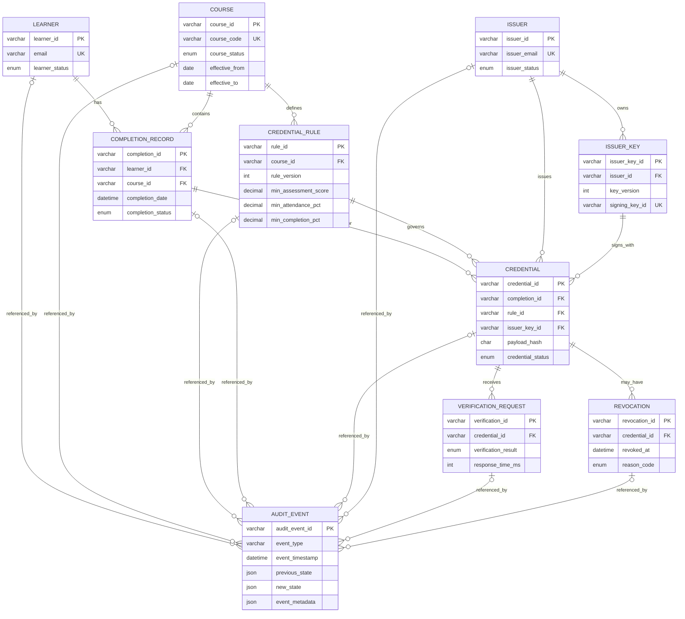

# Entity Relationship Diagram

The diagram reflects the ten tables defined in `database/schema.sql`. `issuer_key` is the additional supporting entity.

## Relationship notes
- Credential-to-completion, credential-to-rule/course, and credential-to-issuer-key/issuer use composite foreign keys to prevent mismatched parent identities.
- The schema restricts deletes and updates on referenced parent keys.
- `audit_event` uses nullable foreign keys because one event targets a subset of the entities.
- Credential issuance history is sequenced with `issuance_number`; the pair `(completion_id, issuance_number)` is unique.
